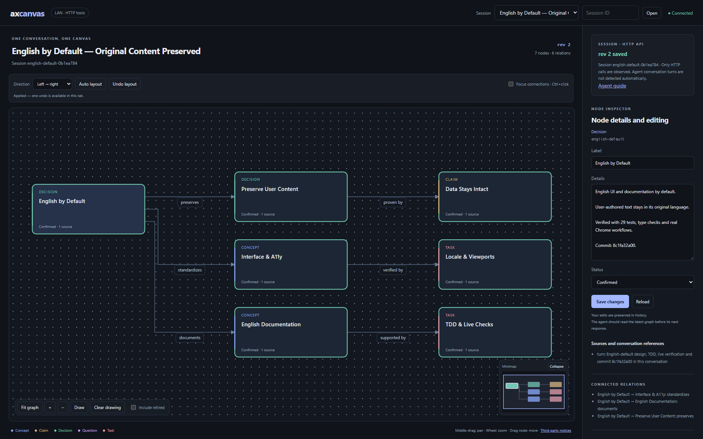

# axcanvas

**An agent-neutral knowledge canvas.** Agents write answers as nodes and relationships through a local HTTP API; people edit the same graph, draw annotations and submit feedback.

Experimental software. No authentication. Local use by default; explicitly trusted LANs only when enabled. **Do not expose the server to the internet.**

The interface and public documentation default to English. User-authored graph content and feedback retain their original language; no agent plugin, MCP/WebMCP server or skill installation is required.



The screenshot documents the English-default implementation. It is an example graph, not a claim that conversations are captured or translated automatically.

## Quick start

Requirements: **Node.js >=24.16**, npm and Git. Clone the repository and start the local server:

```sh
git clone https://github.com/layorixinc/axcanvas.git
cd axcanvas
npm ci --omit=dev
npm start
```

Open **http://127.0.0.1:43821**. The default listener is loopback, not all network interfaces. Runtime data is stored in `.axcanvas/graph.sqlite`.

For development and browser tests, use `npm ci` without `--omit=dev`.

## Connect an agent

Ask your existing agent:

> Read http://127.0.0.1:43821/agents.md and use its HTTP tools to write this conversation as a knowledge graph. Reuse one stable sessionId, show me the returned canvasUrl, and read the latest graph and pending feedback before each update.

Use the agent's conversation ID if it is available; otherwise generate a UUID once and reuse it. Resume with the same sessionId or canvas link.

### Your first graph

1. Keep the server running and open the local URL.
2. Send the prompt above to an agent that can make HTTP requests. The agent should create a session, submit graph content and give you its canvas link.
3. Open that link. If nodes are not arranged yet, choose **Auto layout**, inspect the preview and click **Apply**.
4. Edit a node or draw an annotation, add a note and click **Send to agent**. Ask the agent to read the pending feedback; submission does not automatically wake or interrupt it.
5. Keep the session link when resuming the conversation. The recent-session list belongs to the current browser, not a server-wide directory.

A newly opened session is empty until the first `graph_commit`. You can try the HTTP example below without connecting an agent.

This is **HTTP tool calling, not the MCP protocol**. The server does not automatically collect a conversation, detect turns, interrupt a running CLI or force an agent to call the API. Whether an agent follows the guide depends on that agent and its available HTTP tools.

An agent on another machine needs explicit LAN mode and the server's reachable address, not its own localhost.

## Enable LAN sharing

Only on a network whose participants you trust:

```sh
# macOS / Linux
AXCANVAS_HOST=0.0.0.0 npm start
```

```powershell
# Windows PowerShell
$env:AXCANVAS_HOST = "0.0.0.0"
npm start
```

Use the server computer's LAN IPv4 address on port 43821. Restrict the firewall to the intended local subnet. Do not disable the firewall or enable router port forwarding.

**Anyone with network access and a sessionId can read and modify that session.** Session IDs separate data; they are not authentication. There is no global session directory, and `actor` is only an informational label. See [SECURITY.md](SECURITY.md).

### Configuration

| Environment variable | Default | Purpose |
| --- | --- | --- |
| `AXCANVAS_HOST` | `127.0.0.1` | `0.0.0.0` explicitly enables LAN access |
| `AXCANVAS_PORT` | `43821` | Listener port |
| `AXCANVAS_DB` | `.axcanvas/graph.sqlite` | SQLite database path |
| `AXCANVAS_PUBLIC_URL` | Accepted request origin | Origin returned in links; no path, credentials, query or fragment |
| `AXCANVAS_ALLOWED_HOSTS` | Local interface addresses and localhost | Additional internal DNS hostnames, comma-separated |

The server does not load `.env` automatically. Set environment variables in your shell or process manager. Host/Origin checks, JSON Content-Type validation, a 1MiB request limit and CSP remain active in LAN mode; they do not replace authentication.

## HTTP API

Discovery: `GET /agents.md`, `GET /openapi.json`.

All tool calls use **one endpoint**, `POST /api/agent/v1`:

```sh
curl -sS http://127.0.0.1:43821/api/agent/v1 \
  -H 'Content-Type: application/json' \
  --data-binary '{"requestId":"open-1","sessionId":"demo-session","tool":"session_open","arguments":{"title":"My conversation"}}'
```

This creates or resumes an empty example session. To add its first node on a fresh session:

```sh
curl -sS http://127.0.0.1:43821/api/agent/v1 \
  -H 'Content-Type: application/json' \
  --data-binary '{"requestId":"example-commit-1","sessionId":"demo-session","tool":"graph_commit","arguments":{"baseRevision":0,"answerId":"readme-example","nodes":[{"id":"idea","kind":"concept","label":"A shared knowledge canvas","detail":"Created through the HTTP API. People and agents can edit the same graph.","status":"proposed","sources":[]}],"edges":[]}}'
```

Open http://127.0.0.1:43821/#demo-session to see the node. These curl examples use POSIX shell syntax: use macOS/Linux, Git Bash or WSL. PowerShell users can use this equivalent session-opening call:

```powershell
$body = @{
  requestId = "open-1"
  sessionId = "demo-session"
  tool = "session_open"
  arguments = @{ title = "My conversation" }
} | ConvertTo-Json -Depth 10
Invoke-RestMethod -Uri "http://127.0.0.1:43821/api/agent/v1" -Method Post -ContentType "application/json" -Body $body
```

If you have already edited the example session, read its current revision before submitting a different commit. Re-running the exact successful request returns its original result; it does not reset the graph.

Tools:
- `tools_list`, `session_open`
- `graph_read`, `graph_commit`, `graph_edit`, `graph_layout`, `graph_history`
- `feedback_submit`, `feedback_read`, `feedback_ack`

`tools_list` may omit sessionId; other tools require it. sessionId is 1–128 letters, digits, hyphens or underscores, starting with a letter or digit. The returned `canvasUrl` opens that session.

Input/output JSON Schemas are generated from the actual tool contracts. Inspect them rather than guessing field names. Mutations require a unique requestId and, where applicable, the current revision. `graph_layout` requires **both** baseRevision and baseLayoutRevision.

Errors return a non-2xx HTTP status, `isError:true`, readable `content`, `fieldErrors`, `expectedSchema` and recovery instructions. Validation failures apply nothing and do not reserve requestId: fix the input and retry. Replaying a successful mutation requires the exact original body/requestId; changing its tool, arguments or actor returns 409. For revision conflicts, re-read and reconcile rather than overwriting human edits. Prefer `curl -sS` when the agent needs to inspect error bodies.

## Canvas controls

- Click a node to read details, sources and relationships, or edit its label, detail and status.
- Drag nodes to move them. Drag with the **middle mouse button** to pan, including over nodes and in drawing mode. Wheel zooms; **Fit graph** fits the full graph.
- **Auto layout** previews RIGHT/DOWN layout in a native Web Worker. Apply explicitly, or cancel without saving. **Undo layout** restores the current tab's last applied layout. Unsubmitted edits/drawings block rearrangement.
- **Focus connections** is off by default. **Ctrl+node click** focuses the node and its neighbors; ordinary node selection clears focus. Ctrl+Enter/Space works for keyboard selection.
- The **minimap** shows the graph and current viewport. Click to center, drag the viewport to pan, use arrow keys/Home, or collapse it.
- **Draw** creates annotations. Submit selected nodes, strokes and a note with **Send to agent**. Passive artwork is not an agent command.
- Feedback stays pending until acknowledged. Agents can include feedbackIds in graph_commit to atomically apply a graph change and acknowledge feedback. If a drawing is ambiguous or unsupported, ask rather than pretend it was understood.

Layout changes do not change semantic revisions. Semantic edits or manual node movement invalidate old routes while preserving node coordinates. Layout does not verify the truth of claims or sources, and answers are not automatically rearranged after every turn.

## Data and backups

SQLite WAL stores graph history, layout, successful mutation replay results and submitted feedback snapshots. Only agent-submitted graph content is stored; raw conversations are not collected automatically.

Stop the server before manually copying/deleting the database and its WAL/SHM files, or use SQLite-consistent backups. Back up before resetting data. Existing databases are preserved; publishing the repository does not require deleting local work.

`.axcanvas/`, `artifacts/`, local `.omp/` settings, private historical reports and common secret-file formats are excluded from Git. Ignore rules are not a secret scanner; review every publication candidate. Do not commit real session URLs or private screenshots.

## Troubleshooting

| Symptom | What to check |
| --- | --- |
| Startup fails or `node:sqlite` is unavailable | Run `node --version`; use Node.js 24.16 or newer, then install from the repository root. |
| Port 43821 is already in use | Stop your other axcanvas process or choose another `AXCANVAS_PORT`. Use the same port in the browser and agent URL. |
| The canvas is empty | `session_open` creates no example nodes. The agent or HTTP client must send `graph_commit`; open the returned session URL. |
| The agent cannot reach the server | Test `/health` from the agent's own environment. Its localhost may refer to another machine, container or sandbox. Enable trusted-LAN mode only when needed. |
| Drawing feedback is still pending | Ask the agent to read feedback for the same sessionId. There is no automatic CLI interruption or background model call. |
| A save returns a revision conflict | Reload/read the latest graph, reconcile your edits and submit with current revisions. Copy unsaved text before reloading. |

For LAN access, verify the server address, explicit bind setting and narrow firewall rule. Do not solve connection problems by exposing the port publicly. See [SECURITY.md](SECURITY.md).

## Development

```sh
npm ci
npm run check
npm run test:browser
npm audit --omit=dev
```

The browser runner installs/uses Puppeteer's matching Chrome, creates an isolated temporary database on an ephemeral loopback port and runs actual editing, drawing, layout, focus and minimap workflows. It does not use your live service, LLM credentials or paid model calls. Screenshots go to ignored `test-results/`.

For a preinstalled browser, set `PUPPETEER_EXECUTABLE_PATH`. To skip browser downloads for server/core-only work, set `PUPPETEER_SKIP_DOWNLOAD=true` before installation. The test-only `AXCANVAS_BROWSER_NO_SANDBOX=1` opt-out is reserved for disposable CI; keep sandboxing enabled on your computer.

GitHub Actions defines Windows/macOS/Linux core checks and an Ubuntu browser job. A workflow definition is not evidence that all platforms have already passed.

See [CONTRIBUTING.md](CONTRIBUTING.md), [AGENTS.md](AGENTS.md), [architecture](docs/DESIGN.md), [layout design](docs/LAYOUT-DESIGN.md), [English-default contract](docs/ENGLISH-DEFAULT.md) and [CHANGELOG.md](CHANGELOG.md).

## License

Original project code: [MIT](LICENSE). Dependencies retain their own licenses. ELKjs is used under EPL-2.0, not relicensed as MIT. See [third-party notices](THIRD-PARTY-NOTICES.txt) and [ELK license](licenses/ELKjs-LICENSE.txt). The running UI also links to these notices.
